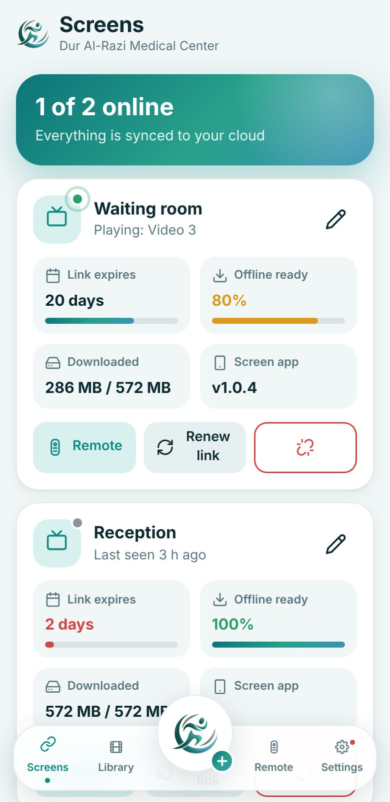
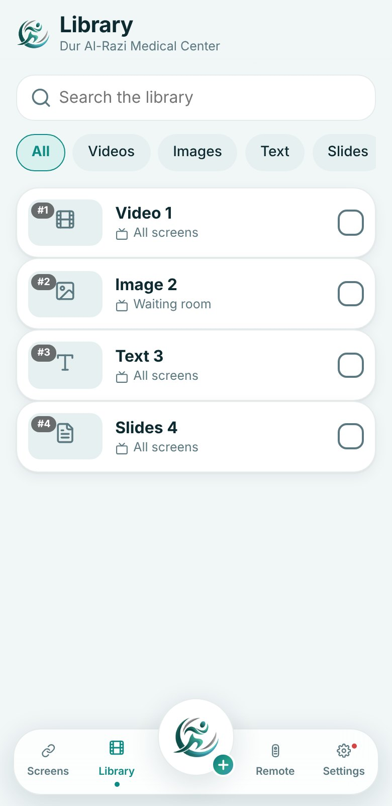
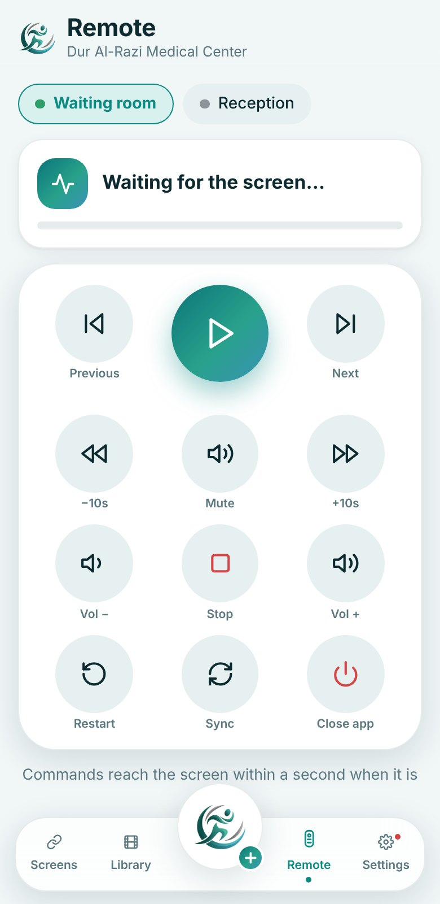
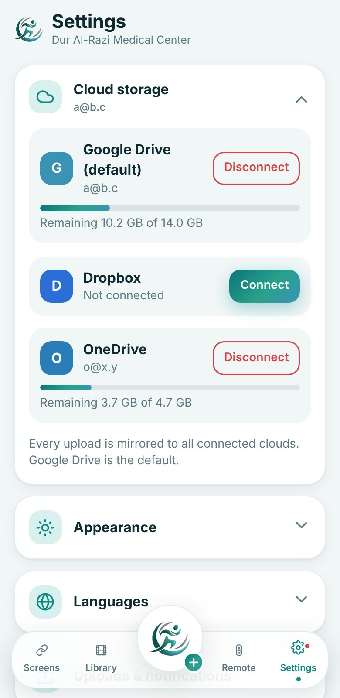

<p align="center">
  
</p>

<h1 align="center">Dur Al-Razi Signage</h1>

<p align="center">
  A free, open-source digital signage system for medical centers.<br>
  Manage the waiting-room screens from your phone. No servers to rent, no monthly fees.
</p>

<p align="center">
  <a href="../../releases/latest"><b>Download the apps</b></a> &nbsp;·&nbsp;
  <a href="docs/SETUP.md">Setup guide</a> &nbsp;·&nbsp;
  <a href="docs/SETUP-AR.md">دليل التثبيت بالعربية</a> &nbsp;·&nbsp;
  <a href="SECURITY.md">Security</a>
</p>

<p align="center">
  
  
  
  
</p>

## What you get

| | |
| --- | --- |
| **Screen app** (Android TV / tablet) | Plays videos, images, slides (PDF / PowerPoint) and text slides in a loop. Shows a 9-digit code to link it. Works offline from downloaded files. Updates itself. |
| **Admin app** (Android phone) | Link screens, upload content in the background, edit the library, control playback live, manage clouds, widgets, share-to-upload from the gallery. |
| **Website** | The same admin interface in any browser, for quick uploads. |
| **Backend** | One Google Apps Script file. Your data stays in your own Google account. |

Highlights

- **Instant remote control**: next, previous, pause, mute, volume, stop. Wireless and fast.
- **Your own cloud**: Google Drive by default, plus Dropbox and OneDrive. Every upload is mirrored to all connected clouds, and the remaining space is shown.
- **Background uploads**: several files at once, progress in the notification and in a draggable bubble, retry with the exact failure reason.
- **Slides with full fidelity**: PDF and PowerPoint pages are shown exactly as designed.
- **Text slide editor**: fonts, colors, effects, alignment and pictures, made for touch.
- **Offline readiness**: see how much of the library each screen has already downloaded, and when its link expires.
- **Automatic updates** from GitHub releases for both apps.
- **Arabic and English**, light and dark themes, adjustable font size.

## How it works

```
  Admin phone  ──────────►  Apps Script backend  ◄──────────  Screens
       │   (list, settings)        (your Google account)        ▲  ▲
       │                                                        │  │
       └─────── Drive / Dropbox / OneDrive (your files) ────────┘  │
       └────────────────── instant commands (ntfy) ────────────────┘
```

## Get started

1. Follow the **[Setup guide](docs/SETUP.md)** once (about 30 minutes, everything free).
2. Install `signage-admin.apk` on the manager's phone and `signage-screen.apk` on the screen, from the [latest release](../../releases/latest).
3. Open the screen app, then in the admin app tap **Screens > Link a new screen** and type the code.

## Security model, honestly

- No keys, addresses or e-mails are stored in this repository. They live in GitHub Actions secrets and Cloudflare variables, and are injected at build time.
- A build is stopped if a key-like value is found in the code ([`scripts/check-secrets.sh`](scripts/check-secrets.sh)).
- Values that an app needs at run time (for example the backend address) are inside the APK and can be extracted by someone determined. Real protection is server side: only the e-mails listed in `ADMINS` can manage anything, Google tokens are verified for every request, and the API key is restricted to the Drive API.

Details in [SECURITY.md](SECURITY.md).

## Repository map

```
apps/screen-android   Android screen player (Kotlin shell + web UI)
apps/admin-android    Android admin app (Kotlin shell + web UI)
web/                  Shared web UI: admin, screen, shared assets
backend/Code.gs       Apps Script backend
scripts/              Build helpers (config from secrets, fonts, secret scan, release notes)
github-setup/         Workflow files to create under .github/workflows
docs/                 Guides and images
```

## Credits

Made by **[Hasn](https://hasn2mr.pages.dev)**. Fonts: IBM Plex Sans / IBM Plex Sans Arabic, Cinzel, Noto Kufi Arabic, Cairo, Tajawal, Amiri (all SIL OFL). Slides rendering: pdf.js (Apache-2.0). Notifications channel: ntfy (Apache-2.0 / GPL-2.0).
The Dur Al-Razi name and logo are not covered by the license.

Licensed under the [MIT License](LICENSE).

<br>

<div dir="rtl" align="right">

## بالعربية

نظام عرض رقمي مجاني ومفتوح المصدر للمراكز الطبية. تتحكمين بشاشات صالة الانتظار من هاتفك: ربط الشاشات برمز من ٩ أرقام، رفع الفيديو والصور والشرائح والنصوص في الخلفية إلى سحابتك (كوكل درايف وغيره)، وتحكم فوري عن بُعد.

للبدء اتبعي **[دليل التثبيت بالعربية](docs/SETUP-AR.md)** مرة واحدة فقط، ثم نزّلي التطبيقين من **[صفحة الإصدارات](../../releases/latest)**.

</div>
